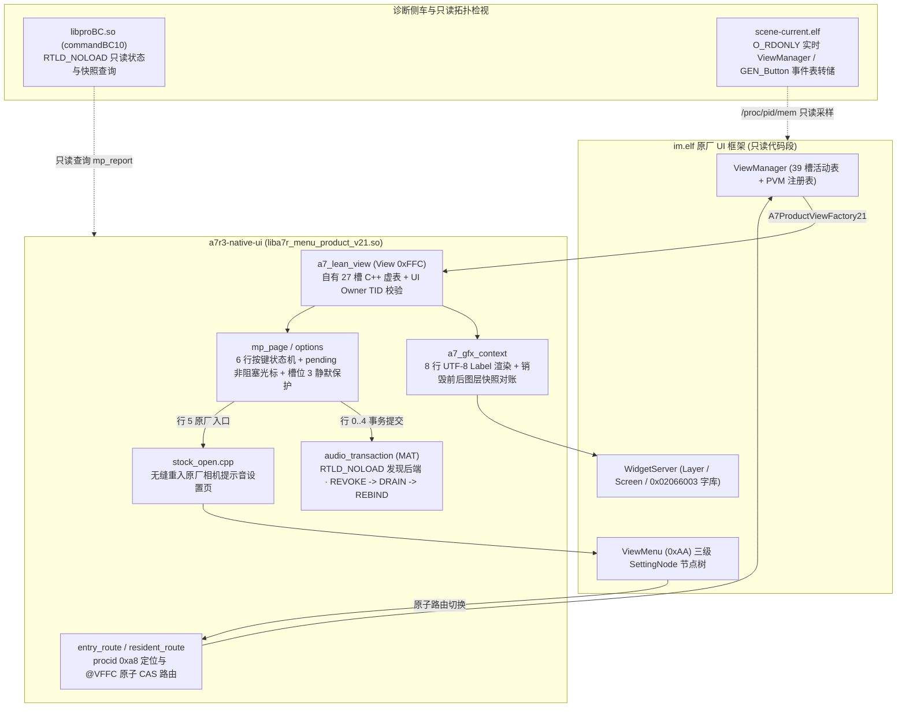

# `a7r3-native-ui` — 索尼 A7R III (FW 3.10) 机身原生视图引擎、菜单路由与自定义设置页框架

[](LICENSE)
[](#系统架构)

`a7r3-native-ui` 是面向 **Sony Alpha 7R III (`ILCE-7RM3`, 固件版本 `3.10`)** 主进程 `im.elf` 的原生 UI 扩展与场景拓扑检视套件，包含自定义 `View 0xFFC` 27 槽 C++ 虚表继承实现、`WidgetServer` UTF-8 中文图层与控件渲染器、`ViewMenu` `SettingNode` 菜单路由接管、C++ 异常边界保护垫片，以及只读活动视图拓扑转储器 `scene-current`。

> [!IMPORTANT]
> **净室构建声明**：本仓库仅包含独立编写的 C / C++ 与 Python 源码及离线测试夹具，不包含任何受版权保护的原厂共享库（`libObj.so`、`viewUnified2.so`、`CautionConfig.so`）或固件二进制。交叉链接与原厂符号检视均通过环境变量 `A7R3_FW_ROOT` 以只读方式引用用户自备解包目录。

---

## 免责声明

> 大家请以学习为目的使用本仓库⚠️⚠️⚠️⚠️，[安全研究法律边界与合规须知](./DISCLAIMER.md#法规与合规参考)
>
> 本仓库的所有内容仅供学习和参考之用，禁止用于商业用途。任何人或组织不得将本仓库的内容用于非法用途或侵犯他人合法权益。本仓库所涉及的固件分析、系统逆向与硬件接口研究技术仅用于个人合法自有设备上的学习与研究，不得用于未经授权侵入或破坏他人设备、绕过技术保护措施、提取或传播第三方专有固件或其他非法行为。对于因使用本仓库内容而引起的任何法律责任、硬件损坏（变砖）、数据丢失或保修失效，本仓库及作者不承担任何责任。使用本仓库的内容即表示您同意本免责声明的所有条款和条件。
>
> 点击查看更为详细的免责声明。[点击跳转](./DISCLAIMER.md)

---

## 设计概览

在单进程 `im.elf` 独占整机显示与输入分发的封闭架构下，构建一套可与机身菜单体系无缝融合的原生设置界面，核心难点在于既不能静态篡改闪存中的 `viewUnified2.so` / `CautionConfig.so` 二进制文件，也不能破坏原厂 UI 线程的对象生命周期与 C++ 异常传播语义。`a7r3-native-ui` 将整套机身 UI 扩展收敛至运行态内存完成，并与后端功能模块保持松耦合边界。

在视图构造与渲染层，`lean_view.c` 按原厂 `View` 基类布局（基类跨度 `0x28`）在自有内存中构造完整的 27 槽主虚函数表与 RTTI 头，向 `ViewManager` 注册独立视图工厂 `A7ProductViewFactory21`（`View 0xFFC`）。进入页面时，`graphics.c` 在验证 UI 所属线程 `TID` 与保留图层快照后，向 `WidgetServer` 申请专属图层，绑定机身内置 `24pt` UTF-8 字库资源（`0x02066003`）创建 8 个原生 `Label` 控件（`0x370` 字节），执行多字节字符完整性检查以防止 UTF-8 截断；退出页面时逐项析构控件、字体与图层，并比对销毁前后的 `Layer` / `Screen` 快照确保零对象泄漏。

在菜单入口与跨模块协同层，引擎只读遍历 `ViewMenu`（`0xAA`）的三级 `SettingNode` 节点树定位目标配置项（`procid == 0xa8`），通过原子 `CAS` 将目标路由名挂载为 `@VFFC`，并在菜单内部提供一键跳转回原厂对应设置页的回退入口（`stock_open.cpp`）；所有跨越 `libstdc++.so.6.0.14` 边界的调用均由独立 C++ `try/catch` 垫片包裹。页面控制器通过 `RTLD_NOLOAD` 按需发现后端音频服务（如 [`a7r3-custom-shutter`](https://github.com/sony-a7r3-research/a7r3-custom-shutter)），以 `REVOKE -> DRAIN -> REBIND` 异步事务栅栏驱动状态切换，同时向触控引擎（[`a7r3-full-touch`](https://github.com/sony-a7r3-research/a7r3-full-touch)）暴露标准化的只读几何与状态快照接口。

---

## 系统架构



### `View 0xFFC` 六行原生页面交互定义

| 行号 | 界面显示文本 | 交互行为 |
| :---: | --- | --- |
| `0` | `关闭` | 排空并关闭外部快门音效门控，恢复静默或原厂行为 |
| `1` | `自定义音效 1` | 通过异步事务栅栏切换并绑定槽位 1 音频资产 |
| `2` | `自定义音效 2` | 通过异步事务栅栏切换并绑定槽位 2 音频资产 |
| `3` | `自定义音效 3` | 预留第三槽位；未配置资产时显示 `音效3未配置` 并保持静默，不回退播放其他槽位 |
| `4` | `重新加载 SD 卡` | 触发后端重新解析 `/dev/mmcb` 当前动态盘符并校验重载音频资产 |
| `5` | `相机提示音` | 透传打开索尼原厂 `Audio Signals` 设置子页 |

---

## 目录结构

```text
a7r3-native-ui/
├── DISCLAIMER.md                       # 法律合规与硬件风险免责声明
├── LICENSE                             # MIT 许可证 + 商标与硬件安全声明
├── Makefile                            # 离线测试、ARMv7 构建与符号检视入口
├── pyproject.toml                      # Python 项目元数据与可选依赖声明
├── include/
│   └── audio_abi/                      # 跨模块 RTLD_NOLOAD 只读通信结构体契约头文件
├── menu-ui/                            # View 0xFFC 原生视图引擎与菜单控制器源码
│   ├── lean_view.{c,h}                 # 27 槽 C++ View 虚表构造与生命周期回调
│   ├── graphics.{c,h}                  # WidgetServer 图层、24pt UTF-8 字库与 8 行 Label 渲染
│   ├── graphics_registry.c             # Layer / Screen 链表只读快照对账
│   ├── entry_route.{c,h}               # ViewMenu (0xAA) SettingNode 三级树定位与 CAS 路由
│   ├── resident_route.{c,h}            # 常驻路由挂载、冲突检测与恢复
│   ├── navigation.{c,h}                # 跨视图导航事件封装
│   ├── stock_open.{cpp,h}              # 原厂设置子页重入桥
│   ├── *_catch.cpp                     # 跨 libstdc++.so.6.0.14 C++ 异常边界保护垫片
│   ├── menu_snapshot.{c,h}             # 39 槽 ViewManager 与 PVM 双向链表只读快照器
│   ├── map_reader.{c,h} / menu_maps.*  # 有界 /proc/self/maps 段映射解析器
│   ├── page_control.{c,h} / options.*  # 6 行菜单状态机、pending 非阻塞导航与槽位 3 保护
│   ├── audio_transaction.{c,h}         # REVOKE -> DRAIN -> REBIND 后端异步事务栅栏
│   ├── audio_native.{c,h}              # 基于 RTLD_NOLOAD、dladdr 归属与 ABI 握手的后端松耦合绑定
│   ├── power_lifecycle.{c,h}           # INACT / ACT 电源休眠与唤醒门控
│   ├── product.{c,h} / diagnostic.*    # 常驻模块主入口 (liba7r_menu_product_v21.so)
│   ├── control.c                       # 只读诊断侧车入口 (libproBC.so / commandBC10)
│   └── codec.py / d010_codec.py        # 主机端 BC10 / D010 协议编解码器
├── scene-inspector/                    # 活动视图与控件树只读拓扑转储器 (scene-current.elf)
│   ├── scene-current.c                 # 零写入解析 ViewManager、mouse0 命中链与 GEN_Button 21 槽事件表
│   └── probe_identity.h                # FW 3.10 目标 UI 库长度、SHA-256 与指令锚点表
├── verifiers/
│   └── inspect_ui_abi.py               # 基于 --fw-root 的只读 UI 符号与 Thumb 指令检视脚本
├── scripts/
│   ├── build_ui_artifacts.py           # 参数化 zig cc ARMv7 构建与 DT_RELCOUNT=0 审计脚本
│   └── elf_tools.py                    # 纯标准库 ELF32 解析、重定位归一化与安全审计工具
└── tests/                              # 零固件依赖离线测试套件 (Python + Clang ASan/UBSan)
    ├── run_all_tests.py
    ├── test_ui_codecs.py
    ├── test_page.c
    ├── test_audio_transaction.c
    ├── test_map_reader.c
    ├── test_control.c
    └── test_menu_snapshot.c
```

---

## 快速开始与构建说明

### 1. 运行离线单元测试（无需连接相机或固件文件）

依赖宿主机 `python3` 与 `clang`（自动检测并开启 `AddressSanitizer` + `UndefinedBehaviorSanitizer`）：

```bash
make test
```

### 2. 编译静态只读拓扑检视器 `scene-current.elf`（无需外部固件库）

安装 `zig` 后可直接编译静态链接 `musl` 的 ARMv7 场景检视工具：

```bash
make build-scene
```

### 3. 交叉编译完整机身 UI 动态库（需自备解包的 FW `3.10` 根目录）

```bash
A7R3_FW_ROOT=/path/to/verified-3.10 make build-ui
```

构建产物位于 `build/arm-ui/`（自动执行 `DT_RELCOUNT = 0` 修补与无 `RWX` 审计）：
- `liba7r_menu_product_v21.so`（常驻 `View 0xFFC` 菜单模块，通过 ELF 头、`dladdr` 模块归属与 ABI 版本号松耦合绑定后端音频宿主，不锁死对端编译哈希）
- `libproBC.so`（只读 `commandBC10` 状态查询模块）
- `scene-current.elf`（实时视图拓扑转储器）

---

## 许可证

本项目基于 [MIT License](LICENSE) 开源。
